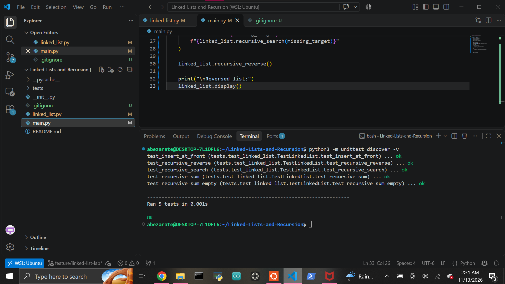

# Linked Lists and Recursion

A Python project demonstrating a singly linked list and recursive algorithms for summing, searching, and reversing node data.

## Features

The project includes:

- A `Node` class
- A `LinkedList` class
- O(1) insertion at the front
- O(n) insertion at the end
- Recursive summation
- Recursive searching
- Recursive in-place reversal
- A readable linked-list display method
- Automated tests using Python's built-in `unittest`

## Project Structure

```text
Linked-Lists-and-Recursion/
├── images/
│   └── tests-passing.png
├── tests/
│   ├── __init__.py
│   └── test_linked_list.py
├── .gitignore
├── __init__.py
├── linked_list.py
├── main.py
└── README.md
```

## Node Class

Each node stores:

- `data` — the integer value
- `next` — a reference to the next node

Example:

```python
class Node:
    def __init__(self, data):
        self.data = data
        self.next = None
```

A linked list can therefore be visualized as:

```text
101 -> 202 -> 303 -> None
```

## LinkedList Class

The `LinkedList` class stores a reference to the first node:

```python
self.head = None
```

It provides methods for insertion, traversal, recursion, and display.

## Insert at Front

`insert_at_front(data)` creates a new node and makes it the new head.

Example:

```python
linked_list.insert_at_front(10)
linked_list.insert_at_front(20)
```

Result:

```text
20 -> 10 -> None
```

Because the operation does not need to traverse the list, its time complexity is:

```text
O(1)
```

## Insert at End

`insert_at_end(data)` traverses the list until it reaches the final node and then attaches the new node.

Example:

```python
linked_list.insert_at_end(5)
```

Because traversal may visit every node, its time complexity is:

```text
O(n)
```

## Recursive Sum

`recursive_sum()` returns the total of all node values.

For this list:

```text
20 -> 10 -> 5 -> None
```

the recursive process is conceptually:

```text
20 + recursive_sum(10)
     10 + recursive_sum(5)
          5 + recursive_sum(None)
              0
```

The final result is:

```text
35
```

The base case is:

```python
if node is None:
    return 0
```

The recursive case is:

```python
return node.data + sum_nodes(node.next)
```

An empty linked list therefore correctly returns `0`.

## Recursive Search

`recursive_search(target)` determines whether a value exists in the linked list.

The recursion stops in one of two base cases:

```python
if node is None:
    return False
```

or:

```python
if node.data == target:
    return True
```

Otherwise, the search continues with:

```python
return search_nodes(node.next)
```

Example:

```text
101 -> 202 -> 303 -> None
```

Searching for `202` returns:

```text
True
```

Searching for `999` returns:

```text
False
```

## Recursive Reverse

`recursive_reverse()` reverses the list in-place.

Starting list:

```text
101 -> 202 -> 303 -> None
```

After reversal:

```text
303 -> 202 -> 101 -> None
```

The recursive helper keeps track of:

- the previous node
- the current node
- the next node

At each step, the current node's `next` reference is redirected toward the previous node.

The base case occurs when:

```python
current is None
```

At that point, the previous node becomes the new head of the linked list.

## Display

The `display()` method prints the list in a readable format.

Example:

```text
101 -> 202 -> 303 -> None
```

## Running the Program

Run the demonstration program with:

```bash
python3 main.py
```

Example output:

```text
Original list:
101 -> 202 -> 303 -> None

Sum of IDs: 606
Search for 202: True
Search for 999: False

Reversed list:
303 -> 202 -> 101 -> None
```

## Running the Tests

This project uses Python's built-in `unittest` framework.

Run all tests with:

```bash
python3 -m unittest discover -v
```

Current result:

```text
test_insert_at_front ... ok
test_recursive_reverse ... ok
test_recursive_search ... ok
test_recursive_sum ... ok
test_recursive_sum_empty ... ok

Ran 5 tests

OK
```

The tests verify:

- insertion at the front
- recursive summation of an empty list
- recursive summation of node values
- recursive searching for existing and missing values
- recursive in-place reversal

## Test Evidence



## Recursion Pattern

The recursive methods follow the same general structure:

```text
Base case
    ↓
Can the problem be answered immediately?

If not:
    ↓
Perform one small step
    ↓
Call the function again on a smaller part of the problem
```

This pattern is used for summing, searching, and reversing the linked list.

## Git Ignore

Generated Python cache files are excluded using:

```text
__pycache__/
*.py[cod]
.pytest_cache/
```

These files are generated automatically and are not part of the project's source code.

## Learning Outcomes

This lab demonstrates how to:

- build a singly linked list
- connect nodes using references
- distinguish a base case from a recursive case
- recursively traverse linked structures
- recursively sum values
- recursively search for data
- reverse a linked list in-place
- understand O(1) versus O(n) insertion
- test data-structure behavior with `unittest`

## Author

Abraham Zarate